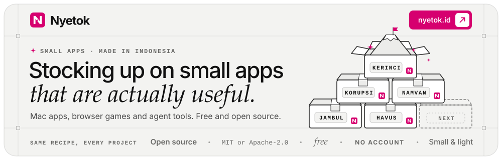

<!-- The banner and the buttons are SVGs in profile/assets, each with a light and a dark variant. To change their
     text or colors, edit scripts/build-profile-assets.py and run: python3 scripts/build-profile-assets.py -->

<a href="https://nyetok.id"><picture><source media="(prefers-color-scheme: dark)" srcset="assets/banner-dark.svg"></picture></a>

<a href="https://havus.web.id"><picture><source media="(prefers-color-scheme: dark)" srcset="assets/btn-havus-dark.svg"></picture></a> <a href="https://saweria.co/nyetok"><picture><source media="(prefers-color-scheme: dark)" srcset="assets/btn-support-dark.svg"></picture></a>

Nyetok is the home of [Debi Kurnia](https://github.com/debikurnia)'s small, native, open-source apps for macOS.
Each one is written in Swift on Apple's own frameworks, with no Electron and no telemetry. In Indonesian, *nyetok*
means stocking up.

| App | What it does | Requires | Download |
| --- | --- | --- | --- |
| [Havus](https://github.com/XNyetok/Havus) [havus.web.id](https://havus.web.id) | A Mac cleaner that minds its own business: caches, logs and developer junk, apps with their leftovers, and large files you rarely open. Everything goes to the Trash first | macOS&nbsp;14+ | [Latest&nbsp;release](https://github.com/XNyetok/Havus/releases/latest) |
| [XSpace](https://github.com/XNyetok/XSpace) | Several isolated browser profiles in one window, each with its own cookies and logins | macOS&nbsp;26+ | [Latest&nbsp;release](https://github.com/XNyetok/XSpace/releases/latest) |
| [Jambul](https://github.com/XNyetok/Jambul) | A Dynamic Island for the MacBook notch, with a timer, Keep Awake, battery peeks and your AI usage limits | macOS&nbsp;14+ | [Latest&nbsp;release](https://github.com/XNyetok/Jambul/releases/latest) |

Releases aren't notarized by Apple yet, so macOS blocks each app the first time it opens. Open the app once,
then go to System Settings → Privacy & Security and choose **Open Anyway**. Each app's README has the details.

Notarizing takes a paid Apple Developer Program membership (US$99 a year). If an app helps you, you can chip in on
[Saweria](https://saweria.co/nyetok). It's voluntary: the apps are free to use either way.

All three apps are MIT-licensed. Bug reports, ideas and pull requests are welcome; each repository's
CONTRIBUTING.md explains how.

**Bahasa Indonesia:** Nyetok bikin aplikasi kecil yang ringan, rapi, dan nggak kepo. Semuanya gratis dan open source, tanpa akun dan tanpa telemetri. Kenalan lebih jauh di [nyetok.id](https://nyetok.id).
